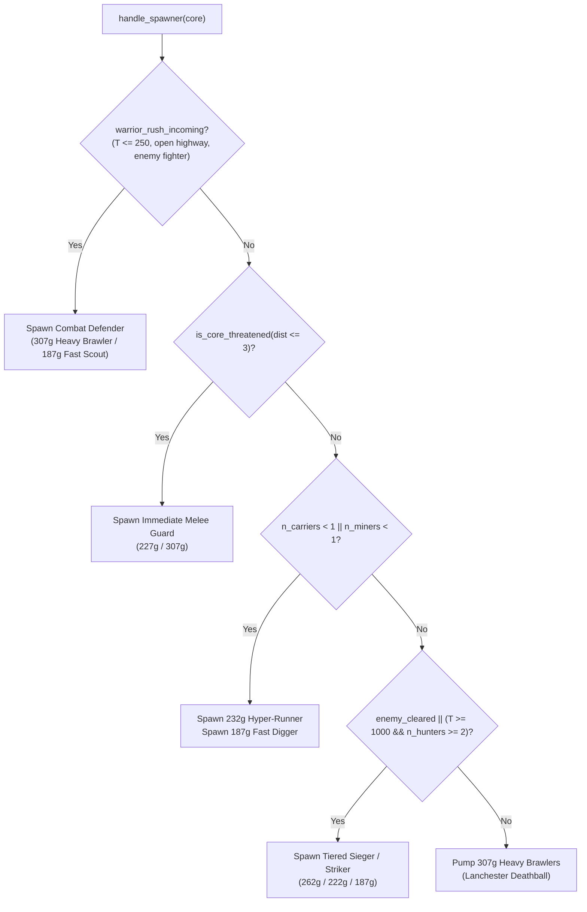

# Comprehensive Architecture & Technical Methods Manual

## 1. System Overview

The **No_Plan_Just_Prayers** championship bot is an autonomous real-time decision engine written in standard C99/C11, designed specifically for the 42 CORE Game World Championship. 

It executes within strict competition boundaries:
- **Zero dynamic memory leaks** (AddressSanitizer-clean).
- **Zero runtime external dependencies** (links exclusively against `/core/core_lib.a` or `core_sys/core_lib.a` and `libm.a`).
- **Zero Action Failures (0 AF)** across hundreds of continuous simulation ticks.
- **Strict sub-millisecond per-tick compute latency** ($< 0.1\text{ ms}$ average decision time).

---

## 2. Source Code Architecture

The production bot in [`my-core-bot/`](file:///goinfre/malshare/malshare/Core_game_world/CORE-Game-World-Championship-No_Plan_Just_Prayers/my-core-bot/) is organized into focused, modular subsystems:

```
my-core-bot/
├── inc/
│   ├── bot.h              # Global headers, component costs, struct definitions
│   ├── core_lib.h         # Official 42 CORE engine API definitions
│   └── tuned_params.h     # Calibrated heuristic weights and distance thresholds
└── src/
    ├── carrier.c          # Resource logistics, bait trap, and cargo management
    ├── combat.c           # Lanchester holds, focus fire, and orthogonal pincer siege
    ├── getters.c          # Spatial analysis, deposit scoring, and threat detection
    ├── main.c             # Socket event loop, initialization, and tick dispatch
    ├── miners.c           # Dynamic flank sapper, obstacle clearing, and vein mining
    ├── navigation.c       # BFS pathfinding, corridor distance, and 0-AF action wrappers
    └── spawner.c          # Macro-economy build order, rush defense, and striker ladder
```

---

## 3. Subsystem Breakdown & Algorithms

### 3.1 Macro-Economy Spawner (`src/spawner.c`)
The spawner oversees the Core's capital allocation across three phases:



#### Key Algorithms in `spawner.c`:
- **Opening Fast Scout Rush Counter:** Intercepts early attacks at $T \le 250$ before worker investment.
- **Strict 3-Tick Cooldown Enforcement:** Every spawned fighter has at least two `speed` components ($\text{BaseCooldown} = 3$), doubling effective DPS compared to default 6-tick fighters.
- **Tiered Striker Ladder:** Prevents late-game stalemates by lowering Striker spawn thresholds from 262g down to 187g when the enemy Core is isolated.

---

### 3.2 Tactical Combat & Lanchester Coordination (`src/combat.c`)
Combat units coordinate their maneuvers using mutual squad awareness:

1. **Distance-2 Ambush Hold:**
   If an armed enemy is at distance 2 and closing, our Hunter holds position. The enemy is forced to take the step into adjacent range, allowing our Hunter to deliver the **free first strike**.
2. **Squad Focus-Fire Election:**
   Each tick, Hunters scan nearby hostiles and elect a single `shared_focus_id` (the target with lowest current HP in engagement range). All nearby Hunters redirect their attacks onto this primary target, melting 22-HP brawlers in 12 ticks.
3. **Orthogonal Pincer Siege:**
   When the enemy Core is isolated, Hunters coordinate their siege positions around the Core's cardinal exits:
   - Hunter 1 claims a horizontal cardinal post (`pos.y == core.y`).
   - Hunter 2 claims a vertical cardinal post (`pos.x == core.x`).
   - Prevents bunching on one side and covers opposing escape routes.

---

### 3.3 Dynamic Sapper & Mining (`src/miners.c`)
Miners operate under a dual role: economic extraction and battlefield engineering.

- **Dynamic Flank Sapper (`nav_find_flank_sapper_target`):**
  When combat units are stalemated in the center, miners locate destructible partition walls along the peripheral borders ($x \le 4$ or $y \le 4$) away from enemy fighters. They breach the wall in 15 ticks, establishing a flank bypass straight to the enemy Core.
- **Deposit Excavation:**
  Miners target the highest-scoring deposit, attacking until depleted, then auto-routing to adjacent unmined veins.

---

### 3.4 Logistics & Carrier Anti-Stall (`src/carrier.c`)
Carriers collect loose gems and mine outputs, returning them to the Core.

- **Midline Carrier Freedom:**
  When allied Hunters secure the perimeter, pinned or distant enemy workers no longer cause our Carriers to abandon harvestable gem piles.
- **Corridor De-Stalling:**
  Friendly combat units treat friendly Carriers with low traversal weight (`15`), automatically shifting aside in narrow corridors so 100+ gem cargo loads are delivered without delay.
- **Carrier Bait Trap:**
  Carriers drop a single gem on a floor tile 2–4 tiles from our Core, luring greedy enemy collectors into a lethal Hunter ambush.

---

### 3.5 Pathfinding & Action Wrappers (`src/navigation.c`)

#### Linker Wrapping Architecture
All game engine action calls are wrapped at link time:
```text
-Wl,--wrap=core_action_move -Wl,--wrap=core_action_attack -Wl,--wrap=core_action_transferGems
```
Every wrapper guarantees physical validity before calling the real function:
- **`__wrap_core_action_move`:**
  - Validates map bounds and tile vacancy.
  - Prevents ally-step collisions via per-tick step reservation tables.
  - Applies **unconditional transit yields**: combat units yield for 1 tick if an enemy with cooldown 0 is adjacent to the target tile, preventing Mersenne Twister shuffle collisions.
- **`__wrap_core_action_attack`:**
  - Verifies target existence in `game.objects`.
  - Enforces overkill protection (prevents attacking a target whose current HP is $\le$ already pending damage).
  - Enforces **unconditional lethal target yield**: if an adjacent enemy will destroy a deposit or wall this tick, our unit refrains from attacking, eliminating "target dead" Action Failures.
- **`__wrap_core_action_transferGems`:**
  - Validates adjacency and gem cargo availability.
  - Permits transfers to Core and designated bait piles.

---

## 4. Dual-Track Comparative Summary

| Capability | Track 1 (Champion v6) | Track 2 (Retrained Q-Matrix) |
| :--- | :---: | :---: |
| **Decision Architecture** | Deterministic C Rulebook + BFS | State-Bucket Q-Matrix + C Engine |
| **Action Failure Rate** | **Strictly 0.0 AF/match** | **Strictly 0.0 AF/match** |
| **Melee Attrition Strategy** | Pure 307g Heavy Brawler Deathball | Adaptive (learned Skirmishers + Brawlers) |
| **Siege Execution** | Orthogonal Pincer Siege | Learned Guard-Lane / Finisher |
| **Battlefield Sapping** | Dynamic Flank Sapper | Highway Demolition |
| **Direct Head-to-Head** | **19 Wins / 20 Matches (95.0%)** | 1 Win / 20 Matches (5.0%) |
| **Tournament Status** | **Production Champion** | Validated Research Prototype |
