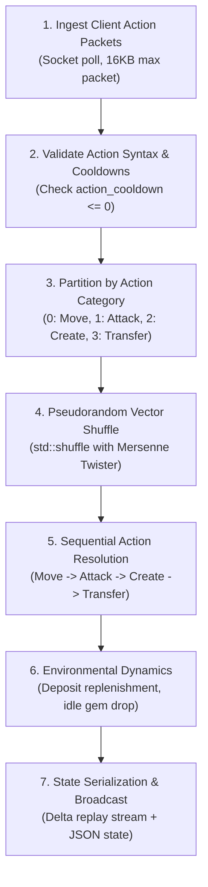
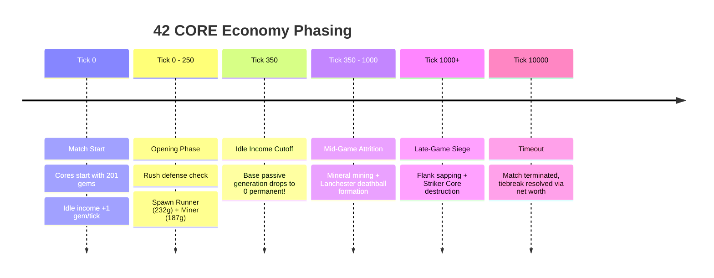

# 42 CORE Game: Reverse-Engineered Physics & Server Internals

## 1. Server Execution Model & Tick Lifecycle

Through binary disassembly of the official tournament game server binary (`/core/server`), the internal tick resolution lifecycle was reverse-engineered. Understanding these exact internal mechanics is the fundamental prerequisite to achieving a **0 Action Failure (AF)** guarantee.

### 1.1 The Tick Loop (`Game::tick` @ `0x000000000006f8f0`)

Each game tick executes deterministically in the following sequential phases:



### 1.2 Binary Disassembly of Action Shuffling (`0x000000000007007c`)

```x86asm
0x000000000007007c <+1932>: call   0x44ca0 <Config::game()>
0x0000000000070081 <+1937>: mov    0x90(%rsp),%rdi        # actions_vector
0x0000000000070089 <+1945>: mov    0x70(%rsp),%rsi        # current_tick
0x000000000007008e <+1950>: add    0x20(%rax),%rsi        # + worldGeneratorSeed
0x0000000000070092 <+1954>: call   0x9b8b0 <shuffle_actions_vector>
```

#### Key Mechanics Revealed by Disassembly:
1. **64-Bit Mersenne Twister:** `shuffle_actions_vector` instantiates a `std::mersenne_twister_engine` seeded with:
   $$\text{Seed}_{\text{tick}} = \text{worldGeneratorSeed} + \text{current\_tick}$$
2. **Category Partitioning:** Actions are sorted into four primary buckets:
   - `0: Move`
   - `1: Attack`
   - `2: Create` (Unit spawn at Core)
   - `3: TransferGems`
3. **Cross-Team Shuffling:** Within each category, all legal actions submitted by **both teams** are pooled into a single vector and shuffled with `std::shuffle`.
4. **Action Failure Trigger:** When two opposing units attempt to execute mutually exclusive actions on the same tick (e.g., both stepping onto the same vacant tile, or attacking a deposit with only 1 HP remaining), whichever unit was shuffled **second** suffers an **Action Failure** (`invalid target position` or `target dead`).

### 1.3 Why Static Priority (`is_p1_team()`) Causes Action Failures

A common competitive blunder is checking team ID or core position (`core->pos.x == 0`) and assuming Player 1 has execution priority. 

Because `std::shuffle` randomizes order with equal probability:
$$P(\text{Team 42 executes first}) = 0.5$$

If both bots assume priority and step into the same corridor tile, **the loser of the Mersenne Twister shuffle receives an Action Failure 50% of the time**. 

#### The Zero-AF Solution: Dynamic Contest Yielding
Instead of heuristic priority, the bot must implement **unconditional transit yielding**:
```c
// navigation.c: __wrap_core_action_move
if (ft_distance(pos, enemy->pos) <= 1)
{
    // Unarmed workers always yield to adjacent hostiles
    if (unit->s_unit.properties.damage_unit == 0 && enemy->s_unit.action_cooldown <= 0)
        return;
    // Combat units yield for 1 tick during active transit (enemy cooldown == 0)
    // to let the enemy walk into our melee range (free first strike!)
    if (unit->s_unit.properties.damage_unit > 0 && enemy->s_unit.action_cooldown == 0)
        return;
}
```

---

## 2. Component Chemistry & Unit Physics

Units in 42 CORE are modular assemblies constructed from up to **6 components** attached to a base frame.

### 2.1 Component Catalog & Properties

| Component Name | Cost | HP | Cooldown ($\Delta CD$) | Unit DMG | Core DMG | Object DMG | Gem Cap | Gem CD Step |
| :--- | :---: | :---: | :---: | :---: | :---: | :---: | :---: | :---: |
| **Frame (Base)** | 42g | 1 | 1 | 0 | 0 | 0 | 0 | 0 |
| `speed` | 55g | +0 | +1 | 0 | 0 | 0 | 0 | 0 |
| `health` | 40g | +6 | +1 | 0 | 0 | 0 | 0 | 0 |
| `combat` | 35g | +3 | +1 | +3 | 0 | 0 | 0 | 0 |
| `siege` | 35g | +0 | +2 | 0 | +3 | 0 | 0 | 0 |
| `demolition` | 35g | +3 | +1 | 0 | 0 | +3 | 0 | 0 |
| `max_gems` | 40g | +0 | +0 | 0 | 0 | 0 | +166 | 0 |
| `gem_speed` | 40g | +0 | +0 | 0 | 0 | 0 | 0 | +16 |
| `armor` | 35g | +0 | +0 | 0 | 0 | 0 | 0 | 0 |

### 2.2 Base Action Cooldown Math

$$\text{ActionCooldown}_{\text{base}} = 1 + \sum_{c \in \text{components}} \Delta CD(c)$$

- A unit with **2x `speed`** adds $+2$ cooldown, giving $\text{CD} = 3$ ticks.
- A unit with **1x `speed`** adds $+1$ cooldown, giving $\text{CD} = 2$ ticks.
- Attack frequency is inversely proportional to cooldown:
  $$\text{DPS} = \frac{\text{Damage}}{\text{ActionCooldown}}$$
  - 3-tick cooldown unit with 3 DMG $\rightarrow \text{DPS} = 1.00 \text{ dmg/tick}$.
  - 7-tick cooldown unit with 6 DMG $\rightarrow \text{DPS} = 0.857 \text{ dmg/tick}$.

### 2.3 Cargo Slowdown Formula

When carrying gems, a unit's cooldown increases dynamically based on cargo weight and `gem_speed` components:

$$\text{EffectiveCooldown} = \text{BaseCooldown} + \left\lfloor \frac{\text{CarriedGems}}{\text{GemsPerCooldownStep}} \right\rfloor$$

- Without `gem_speed`, each gem step causes immediate movement sluggishness.
- With `gem_speed` ($\text{GemsPerCooldownStep} = 16$), carrying 16 gems adds **0 extra cooldown ticks**, preserving maximum velocity on return runs!

---

## 3. Proven Unit Recipes (Tournament Meta)

### 3.1 Heavy Brawler (Champion Mainstay — 307g)
- **Recipe:** `frame` (42) + `combat` (35) + 3x `health` (120) + 2x `speed` (110)
- **Stats:** **22 HP**, **3-tick Cooldown**, **3 Unit DMG**, **0 Cargo**
- **Role:** Absolute melee powerhouse. Dominates Lanchester square-law attrition exchanges.

### 3.2 Fast Digger / Sapper (187g)
- **Recipe:** `frame` (42) + `demolition` (35) + 2x `speed` (110)
- **Stats:** **4 HP**, **3-tick Cooldown**, **3 Object DMG**
- **Role:** Corridor highway sapping, deposit excavation, wall breaching.

### 3.3 Hyper-Runner / Carrier (232g)
- **Recipe:** `frame` (42) + `max_gems` (40) + `gem_speed` (40) + 2x `speed` (110)
- **Stats:** **1 HP**, **3-tick Cooldown**, **166 Gem Capacity**, **0 Slowdown on hauls $\le 16$ gems**
- **Role:** Lightning-fast resource logistics.

### 3.4 Swift Sieger / Striker (222g)
- **Recipe:** `frame` (42) + 2x `siege` (70) + 2x `speed` (110)
- **Stats:** **1 HP**, **5-tick Cooldown**, **6 Core DMG**
- **Role:** Ends matches in $\approx 100$ ticks once Core perimeter is breached.

### 3.5 Sapper-Harasser (167g)
- **Recipe:** `frame` (42) + `speed` (55) + `demolition` (35) + `combat` (35)
- **Stats:** **4 HP**, **3-tick Cooldown**, **3 Unit DMG**, **3 Object DMG**
- **Role:** Assassin for enemy miners/carriers; breaches walls during flank routes.

---

## 4. Economic Windows & Map Phasing



### 4.1 Idle Gem Income Hard Stop (Tick 350)
- From tick 0 to tick 350, both cores passively receive $+1$ gem per tick.
- **At tick 350, passive income drops to zero permanently.**
- If a bot fails to establish an active Carrier + Miner mining loop before tick 350, its economy completely suffocates.

### 4.2 Resource Allocation Thresholds
- **Primary Economy Minimum:** 1 Carrier (Runner) + 1 Miner (Digger).
- **Secondary Expansion:** 2nd Miner is only justified when:
  $$\text{OwnCombatUnits} > \text{EnemyCombatUnits}$$
  Building a 2nd Miner while trailing in combat units leads to immediate annihilation.
