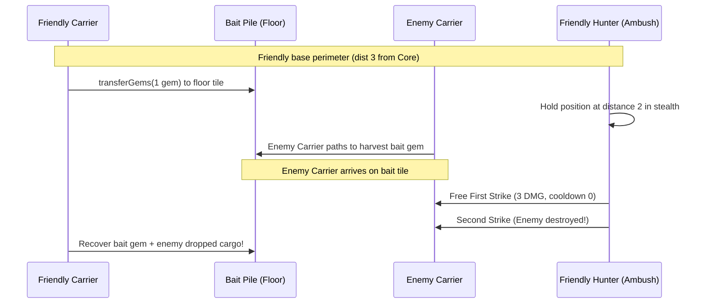

# Tournament Strategy & Championship Playbook

## 1. Swiss Tournament Mechanics & Ranking Optimization

The official 42 CORE Championship employs the **Swiss-system tournament** for group phases, with rankings determined primarily by match wins and broken by the **Buchholz score**:

$$\text{Buchholz Score} = \sum_{\text{opp} \in \text{opponents}} \text{Score}(\text{opp})$$

In a Swiss system:
- In Round 1, teams are seeded or paired randomly.
- In subsequent rounds, teams play opponents with the **exact same match record** (e.g., 1–0 plays 1–0, 3–0 plays 3–0).
- Beating a strong opponent early raises your Buchholz score throughout the entire tournament.

### 1.1 Team "No_Plan_Just_Prayers" Swiss Group Phase Record
In the international group phase, our team achieved an outstanding **Rank 4** standing out of all global teams:
- **Record:** **5 Wins, 1 Loss (5.0 Points)**
- **Buchholz Score:** **17.0**
- **Match Sequence:** `W -> W -> L -> W -> W -> W`
- **Result:** Secured a seeded position in the Championship Playoff Bracket.

---

## 2. Side-Swapped Verification Protocol (The Anti-Fluke Benchmark)

A common mistake in bot tournaments is running a candidate against a reference bot for 2–3 games from a single starting position. In 42 CORE, maps frequently have subtle asymmetry (e.g. proximity of loose gems to Core `(0,0)` vs Core `(19,19)`).

### 2.1 The Standard 20-Match Protocol
Every candidate bot must pass the **20-Match Side-Swapped Benchmark** before promotion:

```python
# scripts/isolated_scrimmage.py
for i in range(1, 21):
    if i % 2 == 1:
        # Odd match: Candidate is Player 1 (Team 42), Reference is Player 2 (Team 43)
        res = run_match(candidate, reference, p1_id=42, p2_id=43)
    else:
        # Even match: Reference is Player 1 (Team 42), Candidate is Player 2 (Team 43)
        res = run_match(reference, candidate, p1_id=42, p2_id=43)
```

### 2.2 Strict Promotion Criteria
A candidate is **REJECTED** unless it satisfies all three conditions:
1. **Statistical Win Rate:** $\text{Win Rate} \ge 60.0\%$ overall against the active champion.
2. **Positional Independence:** Must achieve a winning or neutral record on **both sides** ($\ge 50\%$ as P1 and $\ge 50\%$ as P2).
3. **Zero Action Failures:** **Strictly 0 Action Failures** across all 20 matches under AddressSanitizer.

---

## 3. Opponent Archetype Counter-Strategies

During the championship tournament, opponents divide into four distinct strategic archetypes:

### 3.1 The Fast Scout Rusher (e.g., `Banana`, `Botiful`, `replayv5.json`)
- **Opponent Behavior:** Spawns a 187g Fast Scout (`combat`, `speed`, `speed`) on tick 1, running straight down the central highway to butcher your opening Carrier.
- **Vulnerability:** Extremely squishy (only 4 HP).
- **The Hard Counter:** Open-Highway Warrior Interception at $T \le 250$. The moment an armed enemy is spotted on an open highway without prior economy, spawn a combat defender immediately. If gems $\ge 307$, spawn a 22-HP Heavy Brawler; if gems $\ge 187$, spawn a Fast Scout to match velocity.

### 3.2 The Defensive Turtle / Wall Stalemate
- **Opponent Behavior:** Masses brawlers in front of their base, refusing to advance, and relies on passive mining to win the 10,000-tick net-worth tiebreak.
- **The Hard Counter:** **Dynamic Flank Sapper (`miners.c`)**.
  - While combat units maintain an intimidation perimeter across the center, the Fast Digger breaches peripheral partition walls ($x \le 4$ or $y \le 4$).
  - Fast Siegers (Strikers) slip through the breached flank and demolish the undefended Core.

### 3.3 The Heavy Melee Deathball (e.g., `Champion v5`, `GerhardReinlunzen`)
- **Opponent Behavior:** Masses pure 307g Heavy Brawlers (22 HP, 3 CD).
- **The Hard Counter:** 
  - **Never buy cheap skirmishers.** Match the 307g Heavy Brawler recipe strictly.
  - Enforce the **Distance-2 Ambush Hold** so the enemy steps into melee range first, absorbing free first strikes.
  - Coordinate **Focus Fire (`shared_focus_id`)** to focus down one enemy at a time.

### 3.4 The Loose Gem Snatcher
- **Opponent Behavior:** Builds high-speed unarmored runners to contest center loose gems.
- **The Hard Counter:** Midline Hunter Zoning. Hunters push slightly ahead of Carriers to zone out enemy snatchers, granting our Carriers unhindered access.

---

## 4. Tactical Weapon: The Carrier Gem Bait Trap

The bait trap is a deceptive psychological tactic designed to eliminate enemy Carriers early in the match:



### 4.1 Implementation Code
```c
// carrier.c: Bait Trap Logic
t_obj *bait_pile = find_near_base_gem_pile(core->pos, 2, 4);
if (bait_pile && carried_gems >= 2 && ft_is_adjacent(u->pos, bait_pile->pos))
{
    // Drop 1 gem into the bait pile to lure greedy enemy workers
    core_action_transferGems(u, bait_pile->pos, 1);
}
```

---

## 5. End-Game Transition Rules

1. **Board Cleared State (`enemy_combat_units == 0`):**
   - Immediately unlock and prioritize **Striker** production.
   - Do not spend gems on additional Brawlers or Miners.
2. **Core Perimeter Secured:**
   - At least 1 Hunter is within distance $\le 5$ of the enemy Core.
   - Hunters lock into **Orthogonal Pincer Posts**, denying enemy spawns.
3. **Match Stale Clock ($T \ge 1,200$):**
   - Automatically relax Striker thresholds down to 187g to guarantee a match closure before timeout.
