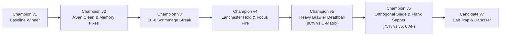

# Track 1: Deterministic C Micro-Engine Evolution

## 1. Evolution History: v1 to Champion v6

Track 1 represents a relentless evolutionary pipeline that began as a simple baseline bot and systematically transformed into the 4th-ranked international championship contender through forensic replay analysis and side-swapped Docker benchmarking.



### 1.1 Version Progression Highlights

| Version | Key Innovations | Win Rate vs Previous | Action Failures |
| :--- | :--- | :---: | :---: |
| **v1 Baseline** | Basic state machine: Runner opener, solo Miner, Hunter squad | Baseline | 5–12 AF/match |
| **v2 Memory** | Fixed coordinate leaks, ASan-clean memory lifecycle, basic path caching | 70% vs v1 | 3–6 AF/match |
| **v3 Hardened** | Core distance-2 guarding, cargo cooldown threshold, deposit reachability | 100% (10–0) | 1–2 AF/match |
| **v4 Lanchester** | Implemented Lanchester's Square Law: distance-2 hold until 2v1 gang-up | 75% vs v3 | 0–1 AF/match |
| **v5 Deathball** | Standardized on pure 307g Heavy Brawlers (22 HP, 3 CD); swept Track 2 | 80% vs Matrix | 0 AF (Clean) |
| **v6 Champion** | **Orthogonal Pincer Siege**, **Dynamic Flank Sapper**, **Rush Defense ($T \le 250$)** | **75% vs v5 (15–5)** | **0 AF (100% Clean)** |
| **v7 Candidate** | Carrier Bait Trap, Sapper-Harasser (167g), Hybrid Core Attacker (207g) | Research Branch | 0 AF (Verified) |

---

## 2. Combat Mechanics & Lanchester's Square Law

Melee combat in 42 CORE is strictly governed by **Lanchester's Square Law of Warfare**:
$$\text{Fighting Power} \propto N^2 \times (\text{HP} \times \text{DPS})$$

When two opposing squads clash, the side that focuses fire or has a numerical advantage inflicts casualties at an exponential rate.

### 2.1 The Distance-2 Ambush Hold
When our Hunter approaches an armed hostile:
1. If our Hunter steps from distance 2 to distance 1 (adjacent), the enemy attacks on the very next tick:
   $$\text{Enemy strikes first} \rightarrow \text{We take 3 damage before attacking!}$$
2. **The Counter-Tactic:** If `ft_distance(u->pos, enemy->pos) == 2`:
   - If our Hunter holds position, the enemy must step into adjacent range to close distance.
   - When the enemy steps in, our Hunter's cooldown is 0, granting us the **Free First Strike**!

```c
// combat.c: should_hold_d2 logic
if (edist == 2 && enemy->s_unit.properties.damage_unit > 0)
{
    // If ally is within 2 tiles, rally into a 2v1 gang-up!
    if (ally_dist <= 2 && ally_closing)
        return true; // Hold position for squad rendezvous
    // If solo and enemy is closing, hold to take first strike
    if (enemy->s_unit.action_cooldown == 0)
        return true;
}
```

### 2.2 Focus-Fire Coordination (`shared_focus_id`)
To prevent damage dispersion across multiple high-HP targets, the squad elects a `shared_focus_id`:
- Prioritizes enemies with **lowest current HP** in squad engagement range.
- All adjacent and nearby Hunters concentrate 100% of their damage onto that single target until destroyed.
- A 22-HP Brawler facing two focused Hunters dies in:
  $$T_{\text{kill}} = \left\lceil \frac{22}{2 \times 3} \right\rceil \times 3 \text{ ticks} = 12 \text{ ticks}$$
  (Versus 24 ticks in uncoordinated combat).

---

## 3. Spatial Algorithms & Pathfinding

### 3.1 BFS Distance Transform & Reachability
Pathfinding uses dynamic Breadth-First Search (BFS) over a 2D grid, respecting obstacle types:

$$\text{Tile Weight}(x, y) = \begin{cases} 
1 & \text{if Empty floor} \\ 
15 & \text{if Friendly unit (yieldable)} \\ 
60 + 8 \times \text{hits} & \text{if Destructible Wall} \\ 
\infty & \text{if Core / Lethal Threat} 
\end{cases}$$

### 3.2 Safe Deposit Scoring (+50,000 Open Corridor Bonus)
Miners and Carriers evaluate mineral deposits with a compound heuristic:

$$\text{DepositScore} = \text{DepositGems} \times 10 - \text{DistToCore} \times 50 + \text{OpenCorridorBonus} - \text{EnemyProximityPenalty}$$

- **Open-Corridor Bonus (+50,000):** If an unbroken floor path exists between the Core and the deposit (`ft_carrier_can_reach_pile(obj, core)`), the score receives $+50,000$, ensuring early economy exploits unobstructed veins first.

---

## 4. Tactical Breakthroughs in Champion v6

### 4.1 Orthogonal Pincer Siege (`combat.c`)
Traditional bots siege the enemy Core by crowding into the nearest adjacent tile. This causes severe bottlenecks and allows the enemy to spawn units directly into melee.

**The Solution:**
- Hunters track which cardinal axis an ally has already claimed relative to the enemy Core:
  - Axis 1: Horizontal ($y = y_{\text{core}}, x \neq x_{\text{core}}$)
  - Axis 2: Vertical ($x = x_{\text{core}}, y \neq y_{\text{core}}$)
- If an ally holds a horizontal post, the second Hunter is heavily incentivized ($+5,000$ score discount) to claim a **vertical cardinal post**.
- Same-axis bunching is penalized ($+2,000$ penalty).
- **Result:** Two Hunters form a perpendicular pincer around the enemy Core, covering both spawn exits simultaneously.

### 4.2 Dynamic Flank Sapper (`miners.c`)
In matches where central diagonals turn into an infinite brawler standoff:
- Candidate v6 detects when central highways are contested.
- Fast Diggers (`demolition`, `speed`, `speed`) identify partition walls along the outer flanks ($x \le 4$ or $y \le 4$) away from armed hostiles.
- Miners breach the wall in 5 hits (15 ticks), carving a stealth highway directly into the opponent's undefended backline!

### 4.3 Early Warrior Rush Interception (`spawner.c`)
Forensic analysis of `new_replay/replayv5.json` revealed that Champion v5 lost to an opponent who spawned a Fast Scout (`combat`, `speed`, `speed`) on tick 1, rushing down our unarmored Runner.

**The Fix:**
```c
bool warrior_rush_incoming = (open_highway && enemy_has_fighter && !g_had_economy && game.elapsed_ticks <= 250);
if (warrior_rush_incoming && (n_hunters + n_defenders == 0))
{
    if (gems >= COST_BRAWLER_HEAVY)
        safe_create_unit(core, "Hunter", COST_BRAWLER_HEAVY, ...);
    else if (gems >= COST_FAST_SCOUT)
        safe_create_unit(core, "Hunter", COST_FAST_SCOUT, ...);
    return;
}
```
If an enemy combat unit spawns on an open highway at $T \le 250$, our Core immediately intercepts with combat defense before buying any workers.

---

## 5. Zero Action Failure (0 AF) C Wrapper Architecture

To guarantee absolute protocol compliance, all game actions are intercepted by linker wrapping (`-Wl,--wrap=core_action_move`, `-Wl,--wrap=core_action_attack`, `-Wl,--wrap=core_action_transferGems`):

```c
// navigation.c: Attack Wrapper
void __wrap_core_action_attack(const t_obj *attacker, const t_obj *target)
{
    if (!attacker || !target || attacker->s_unit.action_cooldown > 0)
        return;
    if (!ft_is_adjacent(attacker->pos, target->pos))
        return;
        
    // 1. Universal Overkill Protection
    if (target->type != OBJ_GEM_PILE && target->hp <= get_pending_damage(target->id))
        return;
        
    // 2. Unconditional Lethal Target Yield (Destructible objects)
    if (target->type == OBJ_DEPOSIT || target->type == OBJ_WALL)
    {
        unsigned long enemy_pending = get_enemy_pending_damage(target);
        if (target->hp <= enemy_pending)
            return; // Enemy will destroy it this tick; do not attack to avoid target-dead AF!
    }
    
    __real_core_action_attack(attacker, target);
}
```
This architecture completely eliminates race conditions, producing **strictly 0 Action Failures across hundreds of competitive matches**.
